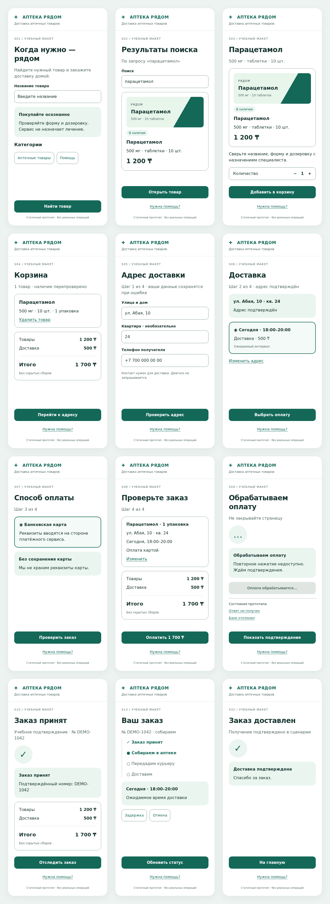

# HCI · Аптека рядом

Учебный HCI-проект интернет-аптеки для покупки известного аптечного товара с доставкой. Приоритеты: понятное состояние системы, предотвращение ошибок и безопасное восстановление. В команде два человека.

Пункты 1–4 составляют **90 баллов** по сведениям команды; MVP — дополнительно **10% от набранного за пункты 1–4**. Подробную рубрику преподавателя ещё нужно подтвердить. По текущему поручению MVP отложен.

| Пункт | Результат | Статус |
|---|---|---|
| 1. Task Flow | [Исходник](diagrams/task-flow.mmd) · [SVG](diagrams/exports/task-flow.svg) · [PNG](diagrams/exports/task-flow.png) | Создан и экспортирован |
| 2. User Flow | [Исходник](diagrams/user-flow.mmd) · [SVG](diagrams/exports/user-flow.svg) · [PNG](diagrams/exports/user-flow.png) | Создан и экспортирован |
| 3. BPMN 2.0 | [XML + DI](diagrams/pharmacy-order.bpmn) · [Обзор](diagrams/exports/pharmacy-order.svg) · [5 детализаций](diagrams/README.md) | XSD и структурные проверки пройдены; SVG/PNG созданы |
| 4. Figma | [Нативный файл](https://www.figma.com/design/eCPOhPRPZCemoEinfGuRh4) · [Статус и исходники](design/README.md) | **Частично: файл и компоненты созданы, экраны заблокированы лимитом Starter MCP** |
| 5. MVP | Отдельный будущий этап | Не начат |

## Что смотреть

1. [Scope, допущения, proto-personas и приоритеты](docs/project-scope.md).
2. [Диаграммы, нотация и объяснение процесса](diagrams/README.md).
3. [Матрица исключений](docs/edge-cases.md) и [Screen / Trigger / State / Action / Next State](docs/screen-map.md).
4. [Статичный дизайн-прототип](design/preview.html) — скачать и открыть локально; это дизайн с переходами, без бизнес-функций.
5. [QA и фактические ограничения](docs/quality-review.md), [план usability-тестов](docs/usability-plan.md), [структурный отчёт](docs/validation.json).



## Автоматическое воспроизведение

Node.js 24, Python 3 + lxml, Chromium, DejaVu Sans. Бесплатные библиотеки; онлайн-редактор не нужен.

```sh
PUPPETEER_SKIP_DOWNLOAD=true npm ci
python -m pip install -r scripts/requirements.txt
npm run check
npm run design:export
```

Если Chromium расположен иначе, задать `CHROME_BIN`. Исходники Mermaid и BPMN, SVG/PNG, генераторы и документация хранятся в репозитории. GitHub Actions повторяет проверки и прикладывает результаты как artifacts; успешный CI запуск не заявлен до фактического выполнения.

Figma не завершена: PNG в репозитории сгенерированы локально, не экспортированы из Figma. Для продолжения нативной сборки сохранены реальные ID и генераторы. Исследования и тесты на реальных пользователях не проводились; «WCAG compliant» и соответствие законодательству не заявляются.
